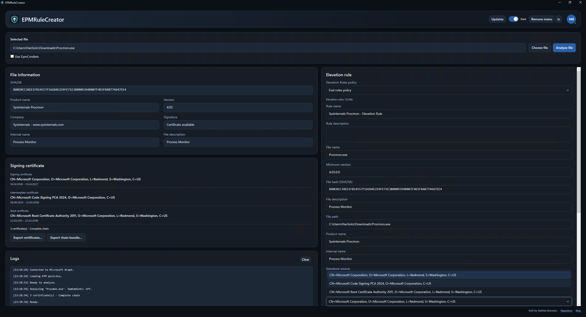

# EPMRuleCreator

**From a file to an Intune EPM rule.**

Check file details and signing certificates, prepare an elevation rule, and upload it to Microsoft Intune when you're ready. File analysis works locally, without signing in.

### [⬇ Download portable EXE](https://github.com/mathiasborowicz/EPMRuleCreator/releases/latest/download/EPMRuleCreator-portable.exe) · [Portable ZIP](https://github.com/mathiasborowicz/EPMRuleCreator/releases/latest/download/EPMRuleCreator-win-x64.zip) · [Download MSI installer](https://github.com/mathiasborowicz/EPMRuleCreator/releases/latest/download/EPMRuleCreator-win-x64.msi)

Extract the ZIP and open `EPMRuleCreator.exe`.

## 🚀 Get started

1. Use the portable ZIP directly, or install the MSI for Start menu, desktop, and Explorer integration.
2. Select a file and click **Analyze file**. Review the file details, certificates, and prefilled rule.
3. Want to upload? Sign in, select a policy or **+ Add new**, and click the upload button.

That's it. You can also use the tool just to inspect files or export certificates.

## ✨ Handy extras

- Export certificates individually or as a chain bundle.
- Choose file-hash or certificate-based rules.
- Add an Explorer right-click entry during installation.
- Switch between light and dark themes.
- Check for updates, or turn automatic checks off.

Right-click a file in Explorer and choose **Create EPM Rule**.

> Upload writes immediately. Test in a test tenant first. New policies need assignments in Intune.

## 📚 Need a hand?

- [Using the tool](docs/UserGuide.md)
- [Installation and updates](docs/Installation.md)
- [Connecting to Intune](docs/GraphAuthentication.md)

Connect to Intune: one-time setup

1. Open the [Entra admin center](https://entra.microsoft.com/) and go to **App registrations > New registration**. Name it **EPMRuleCreator**, select **Accounts in this organizational directory only**, and register it.
2. Under **Authentication > Add a platform > Mobile and desktop applications**, add `http://localhost` and save.
3. Under **API permissions > Add a permission > Microsoft Graph > Delegated permissions**, add `User.Read` and `DeviceManagementConfiguration.ReadWrite.All`.
4. Select **Grant admin consent** for your organization.
5. From **Overview**, copy **Application (client) ID** and **Directory (tenant) ID** into the tool's account panel, then click **Sign in**.

Your sign-in settings and preferences are saved in `%LOCALAPPDATA%\EPMRuleCreator\settings.json`.

[More help with sign-in](docs/GraphAuthentication.md).

## 🤝 Feedback

[Report a bug or suggest an idea](https://github.com/mathiasborowicz/EPMRuleCreator/issues). Include your app version and the relevant error from **Logs**, with personal details removed.

## License

[GNU GPLv3](LICENSE). Commercial use is allowed; redistributed changes must remain under GPLv3 with the corresponding source available. No warranty. Third-party dependencies retain their own licenses.

Independent community project, not affiliated with or endorsed by Microsoft.

Copyright (c) 2026 Mathias Borowicz.
